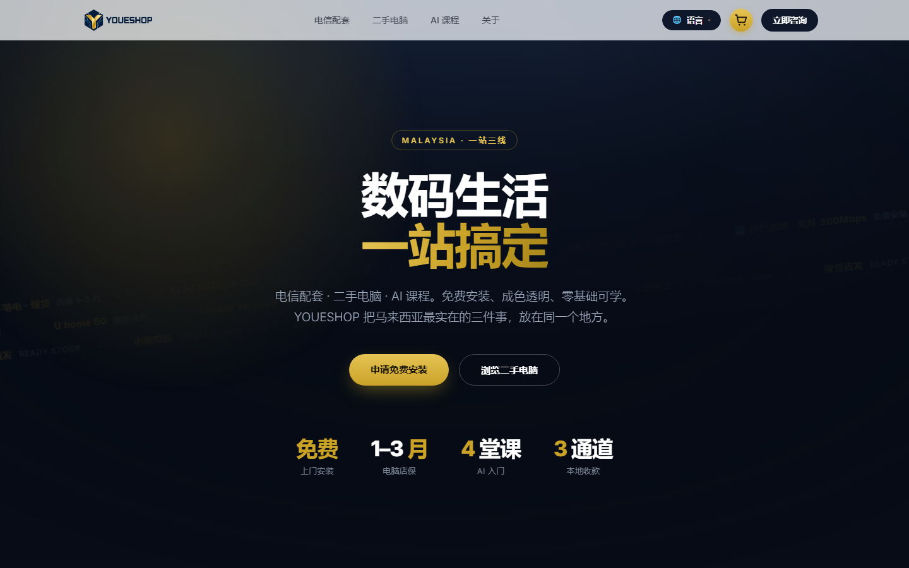
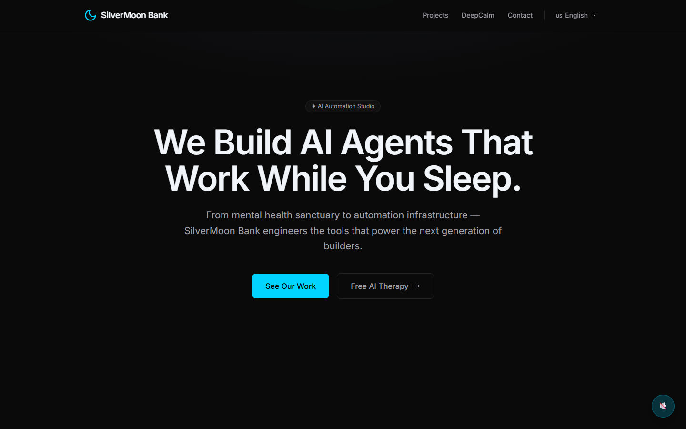
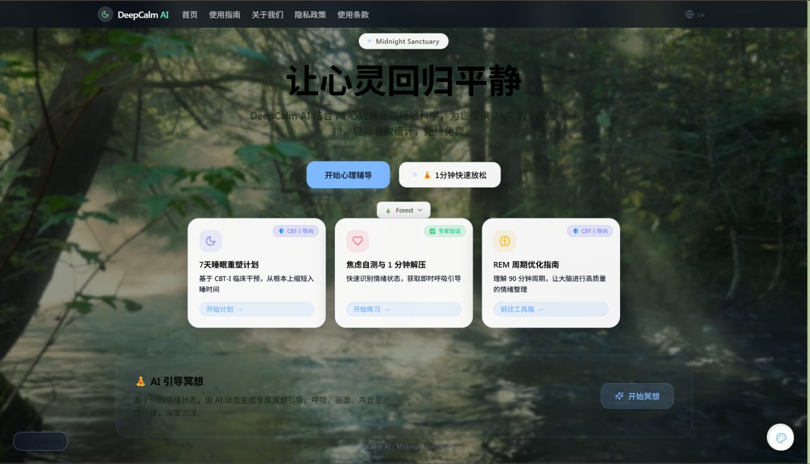
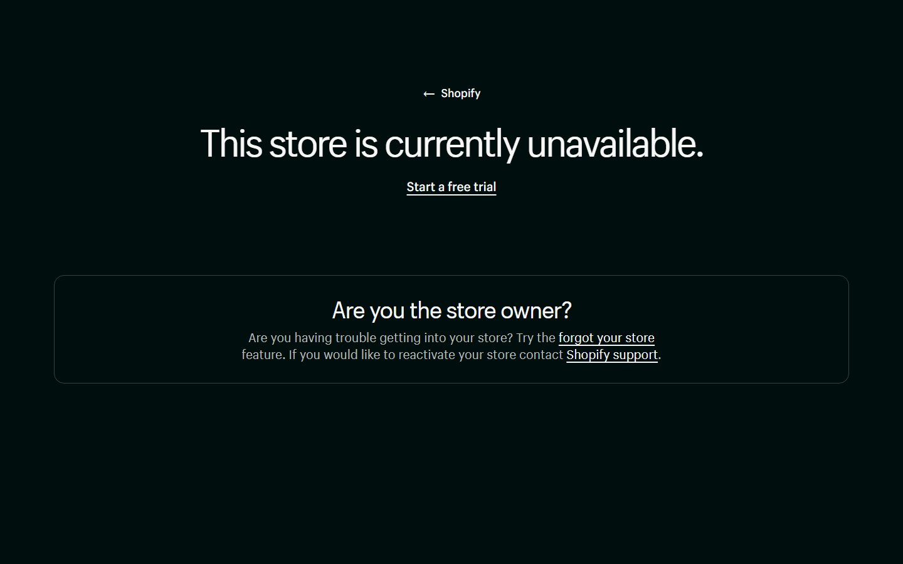
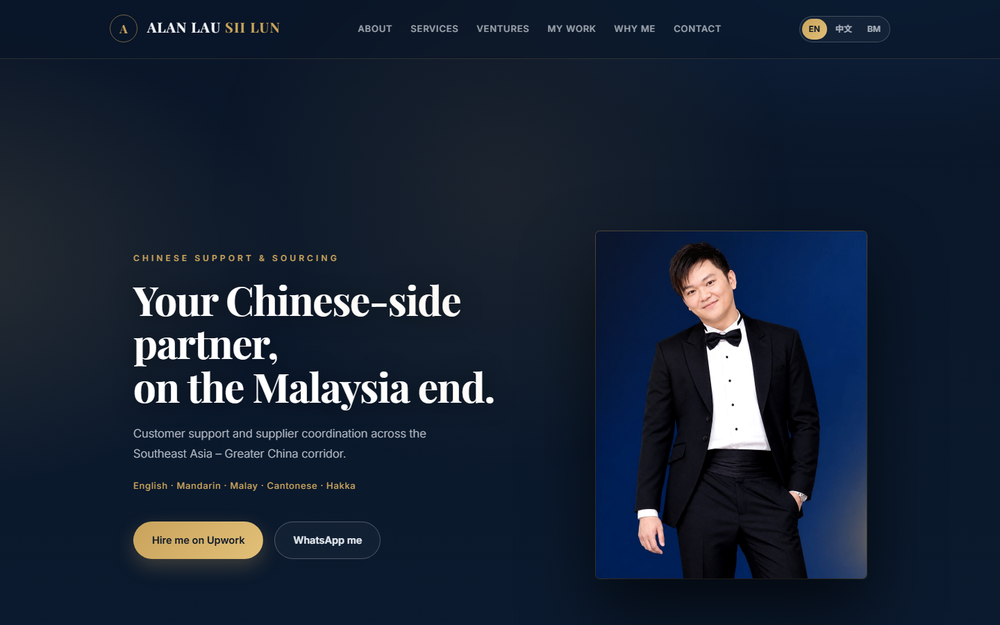
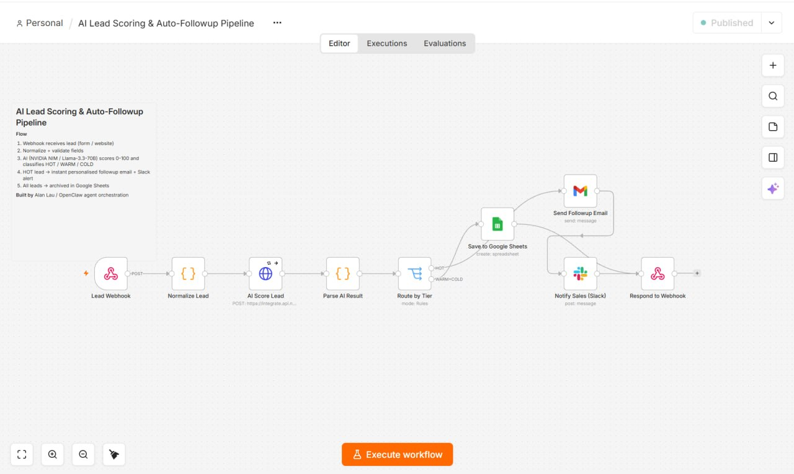

# Alan Lau Sii Lun — Chinese Support & AI Automation

I build websites and run AI automation systems for cross-border teams. I also run my own businesses — everything below is real work, not samples.

🌐 **Personal site:** https://alanlau.vercel.app
🛠 **My work / portfolio:** https://alanlau.vercel.app/work
✉️ **Email:** youeshopent@gmail.com
💬 **WhatsApp:** +60 15-8978 766
📍 **Based in:** Tawau, Sabah, Malaysia (GMT+8)

---

## What I do

- **Chinese customer support & sourcing** — email / live chat / after-sales in Mandarin & English, with AI-assisted triage to cut response time
- **Website building & landing pages** — from design to deployment, built to convert, not just to look good
- **AI workflow automation** — wiring order / support / content flows into systems that run themselves

---

## Projects I built — all by myself

| Project | Preview | Link | What it is |
|---|---|---|---|
| **YOUE SHOP** |  | https://youeshop.vercel.app | Trilingual storefront for 4 business lines · JSON inventory · WhatsApp ordering |
| **SilverMoon Bank** |  | https://silvermoon-openclaw-3s2v.vercel.app | AI automation landing page · bilingual |
| **DeepCalm AI** |  | https://deepcalm-ai.com/en | AI mental wellness + sleep science · 3 languages |
| **AIGenie Vision** |  | https://aigenie-hub.myshopify.com | Digital product store · 5 AI hardware products |
| **Personal brand site** |  | https://alanlau.vercel.app | Trilingual (EN / 中文 / BM) · responsive · navy + gold design system |
| **n8n AI Lead Pipeline** |  | — | 10-node automation: webhook → AI scoring 0–100 → HOT/WARM/COLD routing → instant follow-up email + Slack alert → archived to Google Sheets |

---

## Inside the n8n automation

A real, running 10-node workflow — not a mockup:

```
Lead Webhook  →  Normalize Lead  →  AI Score Lead (NVIDIA NIM)
   →  Parse AI Result  →  Route by Tier (HOT / WARM / COLD)
       ├── HOT  →  Send Followup Email (Gmail)  +  Notify Sales (Slack)
       └── ALL  →  Save to Google Sheets  →  Respond to Webhook
```

**Stack:** n8n Cloud · NVIDIA NIM (`nemotron-3-super-120b`) · Gmail · Slack · Google Sheets · Webhook

*What it does:* every incoming lead gets scored by AI 0–100 and classified. Hot leads get a personalised follow-up email and ping the sales channel within seconds; everything lands in a spreadsheet automatically. Zero manual triage.

---

## Languages

🇬🇧 English ｜ 🇨🇳 中文（简体）｜ 🇲🇾 Bahasa Malaysia ｜ plus Cantonese & Hakka

---

## Get in touch

Best way to reach me is WhatsApp or email. I reply fast, and I work across Asian and European morning time zones.
